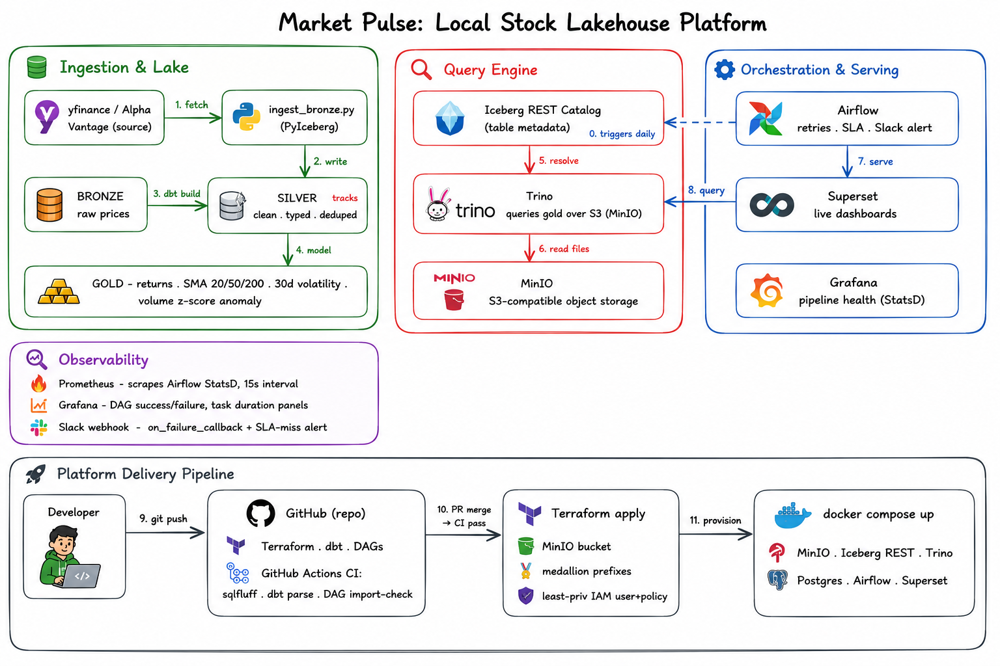

# Market Pulse

An end-to-end stock-market analytics lakehouse built with Apache Iceberg, Trino, dbt, Airflow, MinIO, Terraform, and Superset — runs entirely on a local machine via Docker Compose, with no paid cloud infrastructure required.



The diagram above describes the **Docker Compose reference application**. The independently tested Kubernetes/Flux work is a **disposable pilot**, not a deployment of the complete lakehouse. See [architecture and qualification boundaries](docs/architecture-and-evidence.md) for both systems, the test evidence, and what remains unverified.

> This is a data-engineering demonstration project, not a trading system or investment tool. Market data is sourced from a free third-party feed (yfinance) and may be delayed, incomplete, or revised; nothing here is financial advice.

## What it does

```
yfinance  →  bronze (Iceberg, raw)  →  silver (cleaned, deduped)  →  gold (analytics)  →  Trino  →  Superset
```

Ingests daily OHLCV price bars for a configurable universe of equities (20
today — see `dbt/market_pulse/seeds/ticker_sector_map.csv`, the single
source of truth for the ticker list), lands them raw into an Iceberg bronze
table, cleans and deduplicates them into silver, and computes a gold
analytics layer: daily/rolling returns, 20/50/200-day moving averages,
30-day annualized volatility, and volume-based anomaly detection — all in
dbt-trino SQL, orchestrated daily by Airflow.

**Business questions the gold layer answers:**
- Which tickers have the highest cumulative return over the tracked period?
- What is each sector's average daily return?
- Which trading days had statistically anomalous volume (|z-score| > 3)?
- What is each ticker's 30-day annualized volatility over time?

---

## Key capabilities

- **Incremental + backfill ingestion** — `ingestion/ingest_bronze.py --start` for a full history pull, `--days N` for a daily incremental run; an atomic Iceberg transaction replaces only returned ticker/date keys (see `docs/data-model.md`).
- **Iceberg-backed storage on MinIO** — ACID writes, schema evolution, time travel, all via MinIO's open-source S3-compatible API (no cloud storage account required for local development).
- **dbt-trino bronze → silver → gold** — silver is `materialized='incremental'`; gold recomputes rolling windows as a full table. 16 dbt tests across `not_null`, `unique`, `relationships`, `accepted_values`, `dbt_utils.unique_combination_of_columns`, and a custom `low <= high` expression test.
- **Airflow 3.x (LocalExecutor)** orchestration — `ingest_bronze → dbt_build → validate_gold`, with retries on downstream tasks and optional Slack failure alerting (silently skipped, not failed, if no webhook is configured). An unresolved ingestion commit needs operator review.
- **A Python data-quality gate** (`quality/validate_gold.py`) with its check-interpretation logic unit-tested independent of a live warehouse.
- **Pytest coverage** for ingestion, a local Iceberg catalog, and gold-layer formulas (no live REST/MinIO/Trino in PR CI — see `docs/testing.md`).
- **Terraform-provisioned MinIO** — a single bucket and an IAM policy scoped to only that bucket's ARNs.
- **Pull-request CI** — Python, Terraform, dbt, DAG, Compose, YAML, and workflow static checks; full-stack tests run in separate gated/manual E2E workflows (see Testing below).
- **A manual/weekly E2E workflow** that boots the real stack and runs `dbt build`/`dbt test`/the quality gate against live Trino — see Testing.
- **Optional M3 observability** — Airflow StatsD and a read-only warehouse exporter feed Prometheus/Grafana. Real CI checked metrics, dashboard provisioning APIs, and recovery, **not individual panel rendering** (see [observability evidence](docs/observability.md)).
- **Separate M4 GitOps pilots** — Flux reconciles StatsD and stateful MinIO workloads in a disposable kind cluster; Git-driven rollout, drift correction, and PVC/object persistence passed Linux/amd64 E2E. **Not a full lakehouse migration** (see [M4 qualification](docs/kubernetes-gitops-plan.md)).

---

## Deployment and verification status

| Scope | Verified evidence | Boundary |
| --- | --- | --- |
| Compose lakehouse + M3 monitoring | [Linux/amd64 E2E #45271006974](https://github.com/nhatminh06/market-pulse/actions/runs/45271006974) | Real fixture pipeline, dbt/Gold checks and monitoring APIs; not production-scale data or screenshots |
| Kubernetes/Flux M4 pilots | [Linux/amd64 E2E #45298404500](https://github.com/nhatminh06/market-pulse/actions/runs/45298404500) | Disposable StatsD/MinIO pilots only; no Kubernetes Airflow/Trino/dbt/Superset deployment |
| M4 integration into `main` | [Merged PR #11](https://github.com/nhatminh06/market-pulse/pull/11), [post-merge CI #45301461494](https://github.com/nhatminh06/market-pulse/actions/runs/45301461494) | Normal CI passed at merge commit `45cef312`; M4 E2E tested the earlier implementation commit |
| M5.1 performance baseline | **Blocked** | Isolated runtime capacity unqualified; no timed samples, median, p95, or speedup claim |

See the [architecture and evidence register](docs/architecture-and-evidence.md) for the distinct environments and exact qualification scope.

---

## Data model

| Layer | Table | Write pattern | Current-state grain | Materialization |
|---|---|---|---|---|
| Bronze | `bronze.prices` | atomically replace returned ticker/date keys (see `docs/data-model.md`) | one current row per key written by this ingester | Iceberg table |
| Silver | `silver.stg_prices` | incremental merge on (ticker, trade_date) | one row per (ticker, trade_date) | incremental (merge) |
| Gold | `gold.fct_daily_metrics` | full rebuild each run | one row per (ticker, trade_date) | table |
| Gold | `gold.dim_ticker` | full rebuild each run | one row per ticker | seed-joined |

Full column-level detail, nullability rules, and the exact window-function
formulas behind returns/SMA/volatility/anomaly detection are in
[`docs/data-model.md`](docs/data-model.md).

---

## Quick start

### Prerequisites
- Docker + Docker Compose (≥ 8 GB RAM allocated to Docker)
- Terraform ≥ 1.5
- ~15 GB free disk

### 1. Minimal validation (no Docker required)
```bash
git clone https://github.com/nhatminh06/market-pulse.git
cd market-pulse
pip install pytest ruff pandas pyarrow "sqlalchemy>=2,<3" "pyiceberg[s3fs,pyarrow]==0.7.1" "yfinance==0.2.*" trino
make lint    # ruff + sqlfluff
make test    # pytest, including a local Iceberg catalog; no live stack needed
```

### 2. Full local stack

Order matters here: Airflow/Trino/Iceberg REST read `PIPELINE_ACCESS_KEY`/
`PIPELINE_SECRET_KEY` from `.env` once, at container start — starting them
before Terraform has provisioned those credentials means they'd start with
blank values and need a restart to pick up the real ones. Start only MinIO
first, provision credentials, then start everything else (the same order
`.github/workflows/e2e.yml` uses, which has been verified to work end-to-end).

```bash
cp .env.example .env          # add a Slack webhook to SLACK_WEBHOOK_URL if you want failure alerts
docker compose build          # builds the custom Airflow image

docker compose up -d minio mc-init
cd infra/terraform && terraform init && terraform apply -auto-approve && cd ../..
./scripts/configure-local-env.sh   # writes PIPELINE_ACCESS_KEY/SECRET_KEY into .env, idempotently

docker compose up -d          # starts everything else with correct credentials
```

### 3. Ingest and transform
```bash
# Full history backfill (real yfinance data — can take a while for 20 tickers)
docker compose exec airflow-scheduler python /opt/airflow/ingestion/ingest_bronze.py --start 2015-01-01

# Or: incremental (last N days only)
docker compose exec airflow-scheduler python /opt/airflow/ingestion/ingest_bronze.py --days 5

# Build silver + gold, run all dbt tests
docker compose exec airflow-scheduler bash -c "cd /opt/airflow/dbt/market_pulse && dbt deps && dbt build --profiles-dir ."

# Run the data-quality gate
docker compose exec airflow-scheduler python /opt/airflow/quality/validate_gold.py
```
`make fixture-pipeline` does an equivalent small run against a checked-in
fixture instead of live yfinance, for a fast sanity check.

### 4. Open the UIs
```bash
open http://localhost:8085   # Airflow  (see airflow_auth/ for the generated password)
open http://localhost:8088   # Superset (admin / admin by default — see .env.example to change)
open http://localhost:9001   # MinIO    (minioadmin / minioadmin by default)
open http://localhost:8080   # Trino
```

### 5. Optional: observability
```bash
docker compose -f docker-compose.observability.yml up -d
open http://localhost:3000   # Grafana (admin / admin)
```
See [observability setup and freshness semantics](docs/observability.md). Set a non-default `GRAFANA_ADMIN_PASSWORD` before using Grafana outside a disposable local demo.

### Teardown
```bash
docker compose stop          # preserves data
docker compose down -v       # DESTROYS all data (MinIO objects, Postgres, Iceberg tables)
```

---

## Testing

See [`docs/testing.md`](docs/testing.md) for the full breakdown of what runs
where and why. Short version:

- **Pull-request CI** runs static and fixture checks without a live warehouse: Python tests/lint, `dbt parse`, SQLFluff, DAG import/structure, `docker compose config`, YAML/Action lint, and Terraform fmt/validate. The test count changes as the repository evolves; see the specific CI run.
- **Full-stack Compose E2E runs separately**, not on each PR: [Linux/amd64 run 45271006974](https://github.com/nhatminh06/market-pulse/actions/runs/45271006974) (November 23, 2026) exercised the deterministic fixture with real Trino/Iceberg, 21/21 dbt checks, 4/4 Gold checks, M3 monitoring API checks, and teardown. The [earlier Compose E2E run 45209879444](https://github.com/nhatminh06/market-pulse/actions/runs/45209879444) also passed. The separate [M4 GitOps E2E](https://github.com/nhatminh06/market-pulse/actions/runs/45298404500) qualifies disposable Kubernetes pilots only.
- Gold-layer formulas (returns, SMA, volatility, volume anomaly) are covered as **pandas specification tests** against the exact formulas in `fct_daily_metrics.sql` — not a run of the actual Trino SQL by themselves. Real SQL correctness against live Trino is what the E2E run above verified.

---

## Benchmarks

**M5.1 baseline qualification is blocked.** The existing [benchmark scripts](benchmarks/) and [methodology](docs/benchmarks.md) are not evidence of measured performance. Separate local M5.1 preparation has no qualified isolated runtime or remotely executed benchmark. No startup time, median, p95, or speedup is claimed. The DuckDB/raw-Parquet versus Trino/Iceberg comparison also changes the engine and I/O path, so it cannot establish an Iceberg-only advantage. See the [evidence register](docs/architecture-and-evidence.md).

---

## Screenshots / evidence

No application screenshots have been committed. The [capture checklist](docs/evidence-checklist.md) prioritizes Airflow and Superset UI, Grafana/Prometheus behavior, dbt lineage, Trino/Iceberg results, and optional GitOps evidence. The [90-second demo outline](docs/demo-script.md) is a plan, not an existing recording. Verified CI runs are linked above, but they are not substitutes for screenshots of a running UI. Do not use existing preserved Docker volumes for a disposable capture run.

---

## Design decisions & trade-offs

These reflect what's appropriate at this project's scale (a single laptop,
a 20-ticker universe) — not a claim that any option is universally superior.

**Iceberg over Delta Lake:** an open table-format standard with multi-engine support (Trino, Spark, Flink, Snowflake, BigQuery) rather than tooling concentrated around one vendor — useful here specifically because the stack is meant to be engine-agnostic.

**MinIO over real AWS S3:** MinIO implements the S3 API, so ingestion and table-access code (PyIceberg, Trino, Terraform's MinIO provider) can stay largely unchanged if pointed at real S3 later. A real migration is still real work, not a one-line change: new cloud credentials and IAM policies, network and TLS configuration, a different Terraform provider (or `aws` provider config), catalog endpoint changes, and end-to-end operational validation. What MinIO buys here is local reproducibility and no cloud bill during development, not a finished migration path.

**Trino over Spark for transforms:** this is a SQL-centric transform workload on a small (20-ticker) dataset with no distributed-shuffle requirement, where Spark's cluster-management overhead doesn't pay for itself and Trino's lower operational footprint suits interactive local querying better. This is a scale-appropriate choice, not a claim that Trino outperforms Spark in general — Spark remains the better fit once the workload needs distributed shuffle or ML pipelines at real volume.

**Airflow LocalExecutor over Celery/Kubernetes:** appropriate for one daily DAG on one machine with no message broker or worker fleet to operate. The DAG logic itself wouldn't need to change to run under `CeleryExecutor` or `KubernetesExecutor`, but adopting either is real infrastructure work — a broker (Redis/RabbitMQ) or a Kubernetes cluster, worker deployment and scaling, networking, and secrets management — not a configuration flag.

**What would change at cloud scale:** MinIO → real S3 (new credentials/IAM/networking, not just an endpoint value), LocalExecutor → CeleryExecutor/KubernetesExecutor (added broker or cluster infrastructure), single Trino container → a Trino cluster (EKS/EMR), `docker compose` → Helm charts or ECS task definitions. None of these are free — each carries its own credentials, networking, and operational setup.

---

## Known limitations

- Small local equity universe (20 tickers) — the ticker/sector seed is meant to be extended, not a hard architectural limit.
- Live ingestion depends on yfinance, an unofficial free feed with no uptime or accuracy guarantee; data can be delayed, incomplete, or revised.
- Local Docker Compose is a single-node demo environment, not a production cluster — no hard resource limits are set on any service (only guidance, see Prerequisites). Health checks now exist for every service, but MinIO/Postgres/Trino are the only ones confirmed working against a live container (via the verified E2E run); Iceberg REST, the Airflow API server, and Superset's health checks are best-effort and documented as unverified in `docker-compose.yaml` — nothing else's startup depends on them, so a wrong assumption there shows as "unhealthy" in `docker compose ps`, not a blocked stack.
- Default local credentials (`minioadmin`/`minioadmin`, `admin`/`admin`, Postgres `airflow`/`airflow`) are safe only because nothing is exposed beyond `localhost` — see `.env.example` before running anything reachable from outside your machine.
- M3 monitoring passed a real CI E2E with exporter/Prometheus metrics, provisioned Grafana datasource/dashboard APIs, and a controlled recovery check. Individual dashboard panel rendering, task-duration telemetry, alert firing, and external notification delivery are not established (see [observability qualification](docs/observability.md)).
- The [Compose E2E workflow](.github/workflows/e2e.yml) passed in [run 45271006974](https://github.com/nhatminh06/market-pulse/actions/runs/45271006974) on November 23, 2026. The [M4 GitOps E2E](https://github.com/nhatminh06/market-pulse/actions/runs/45298404500) tested a different commit/scope; [post-merge ordinary CI](https://github.com/nhatminh06/market-pulse/actions/runs/45301461494) passed on `main`. These do not establish that all checks pass on every later commit.
- M5.1 has no qualified performance measurements. The local benchmark preparation checkpoint remains unpublished; runtime resource sufficiency, SQL execution, and peak disk use remain unverified. The published `main` branch must not be described as having completed M5.1.

---

## Roadmap

- Resume M5.1 only when a separate disposable runtime passes capacity and isolation checks; retain raw measurements before making any performance claim.
- Qualify currently best-effort Compose health checks under controlled faults and assess resource limits without risking preserved volumes.
- Capture actual Grafana dashboard panel renders and independently test alert firing/delivery if notification channels are later added; provisioned dashboard APIs and `promtool` checks already exist.
- Add Iceberg snapshot-management / retention policy documentation and a schema-evolution demo (add a column, show old snapshots still queryable) on a live cluster.
- Capture the screenshot evidence in `docs/evidence-checklist.md` and link it from this README.
- Re-run the E2E workflow periodically and keep the verified-run link in Known Limitations current.

---

## Repository structure

```
market-pulse/
├── Dockerfile                          # Custom Airflow image
├── docker-compose.yaml                 # Full local stack
├── docker-compose.observability.yml    # Prometheus + Grafana (optional)
├── Makefile                            # make help
├── .env.example                        # Environment variable template
├── .github/workflows/
│   ├── ci.yml                          # Fast static checks, every PR
│   ├── e2e.yml                         # Full-stack fixture pipeline, manual + weekly
│   ├── m4-gitops-e2e.yml              # Label-gated disposable kind/Flux pilot tests
│   └── docs.yml                        # dbt docs → GitHub Pages, on push to main
├── infra/
│   ├── terraform/                      # MinIO bucket + least-privilege IAM
│   └── postgres/init-superset-db.sql   # Creates the separate `superset` Postgres DB
├── ingestion/ingest_bronze.py          # yfinance → bronze, split into testable stages
├── dbt/market_pulse/
│   ├── seeds/ticker_sector_map.csv     # Ticker universe + sector — single source of truth
│   └── models/
│       ├── silver/stg_prices.sql
│       └── gold/{fct_daily_metrics,dim_ticker,dim_date}.sql
├── quality/validate_gold.py            # Data-quality gate
├── dags/market_pulse.py                # Airflow DAG
├── trino/catalog/iceberg.properties
├── observability/prometheus.yml
├── benchmarks/                         # Query-benchmark scripts (see docs/benchmarks.md)
├── tests/{unit,integration,smoke}/     # Python unit/integration/smoke tests and fixtures
└── docs/
    ├── data-model.md
    ├── testing.md
    ├── benchmarks.md
    ├── architecture-and-evidence.md   # Compose versus GitOps pilot, qualification register
    ├── evidence-checklist.md
    ├── demo-script.md
    └── resume-evidence.md
```

---

## License

MIT — see [`LICENSE`](LICENSE).
