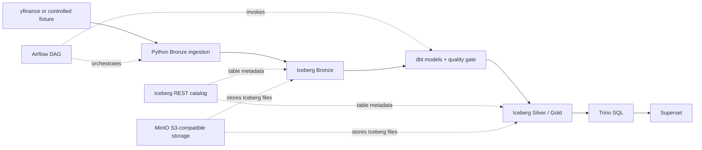
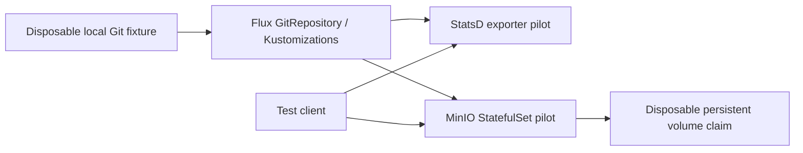

# Market Pulse — architecture and qualification boundaries

The diagrams distinguish the **qualified local Compose lakehouse** from the
**separate disposable Kubernetes/Flux pilot**. They are not one deployed system.
The original [`architecture.png`](../architecture.png) illustrates the local
application; the diagrams below clarify the infrastructure qualification scope.

## Local lakehouse: Docker Compose reference

The full-stack fixture E2E workflow exercises real MinIO, Iceberg REST, Trino,
dbt, and the Gold quality gate. The M3 observability stack is an **optional
Compose add-on** (Airflow StatsD -> StatsD exporter, plus read-only warehouse
exporter -> Prometheus -> Grafana); it does not write to Iceberg.

**Evidence:** [M3 Linux/amd64 E2E run 45271006974](https://github.com/nhatminh06/market-pulse/actions/runs/45271006974)
passed with real Trino results, 21/21 dbt model-and-test checks, 4/4 Gold quality
checks, exporter/Prometheus checks, Grafana datasource and dashboard API checks,
and teardown. It did **not** prove that each Grafana panel renders, that every
panel query has data, or that external alert notifications fire.

## Isolated Kubernetes/Flux pilot: V2-M4

This is a **different, disposable environment**. It does not host the full
Airflow/Trino/dbt/Superset pipeline, and its temporary MinIO volume is not a
Compose volume. Flux reconciles a disposable Git source into Kubernetes,
including drift recovery and a Git-driven MinIO rollout.

**Evidence:** [M4 Linux/amd64 run 45298404500](https://github.com/nhatminh06/market-pulse/actions/runs/45298404500)
passed at implementation commit `cc450e6fede40609fe5ded7f9a8c2f2c092d7dba`.
It checked Flux revisions, StatsD histogram delivery after restart, MinIO
object SHA-256 across pod replacement and rollout, PVC continuity, and scoped
teardown. The feature was merged in [PR #11](https://github.com/nhatminh06/market-pulse/pull/11)
on November 23, 2026 (UTC: November 24), and [post-merge CI 45301461494](https://github.com/nhatminh06/market-pulse/actions/runs/45301461494)
passed on merge commit `45cef3126e99d037ccf4a8374041b7902b1bd4a0`.
See [M4 detailed qualification and limitations](kubernetes-gitops-plan.md).

## Evidence register

| Claim | Classification | Reference / qualification boundary |
| --- | --- | --- |
| Local Bronze -> Silver -> Gold data pipeline and real SQL/quality checks | Verified in disposable Compose E2E | [Run 45271006974](https://github.com/nhatminh06/market-pulse/actions/runs/45271006974); fixture-scale, not production load |
| M3 observability API, export, and failure/recovery behavior | Verified in E2E | [Observability documentation](observability.md); Grafana panel rendering and alert delivery not verified |
| M4 Flux reconciliation, StatsD recovery, and MinIO persistence within a disposable kind cluster | Verified in M4 E2E | [Run 45298404500](https://github.com/nhatminh06/market-pulse/actions/runs/45298404500); not a complete Kubernetes lakehouse |
| M4 merged branch and normal checks | Verified on main | [PR #11](https://github.com/nhatminh06/market-pulse/pull/11), [post-merge CI](https://github.com/nhatminh06/market-pulse/actions/runs/45301461494) |
| Superset visual dashboard and individual Grafana panel rendering | Unverified / no committed screenshots | [Evidence capture checklist](evidence-checklist.md) |
| M5.1 query and startup performance baselines, medians, p95, speedups | **Blocked / no measurements** | Separate local checkpoint is not published; no adequate isolated runtime qualified. Do not assert speedups |
| Cloud availability, backup/restore after cluster loss, production hardening, long-duration reliability | Not established | M4 and M3 are narrowly scoped disposable qualifications |

## Evidence capture policy

No application screenshots are committed as of this refresh. Screenshots must
show actual running software, be checked for secrets, and carry a caption with
the environment, revision, and what the image *actually proves*. GitHub Actions
runs are **CI evidence**, not screenshots of application UI. See the
[evidence checklist](evidence-checklist.md) and [demo script](demo-script.md)
for a safe capture plan. Do not start or reset existing local Docker resources
just to obtain a screenshot.
